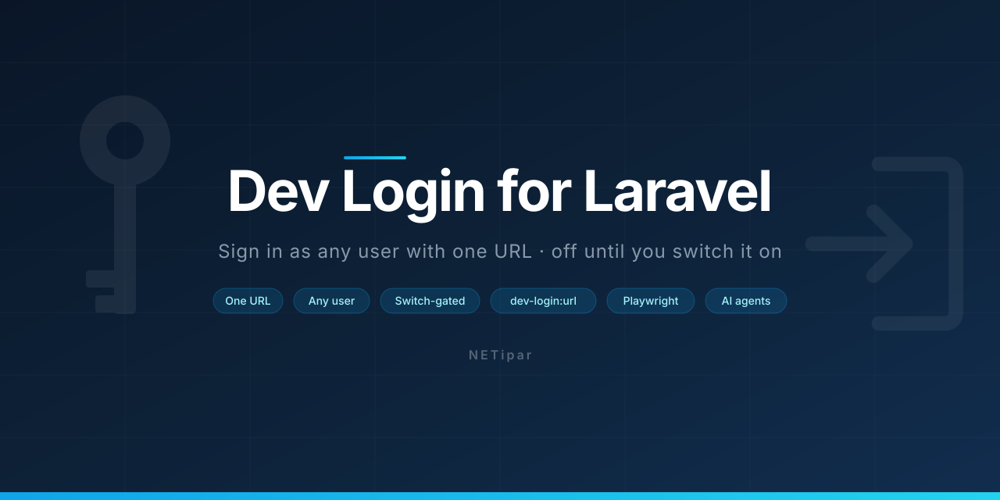

<picture>
  <source media="(prefers-color-scheme: dark)" srcset="art/banner.svg">
  
</picture>

# Dev Login for Laravel

[](https://packagist.org/packages/netipar/laravel-dev-login)
[](https://github.com/NETipar/laravel-dev-login/actions?query=workflow%3Atests)
[](https://packagist.org/packages/netipar/laravel-dev-login)

A development sign-in URL for browser testing: `GET /dev/login/{user}` signs the browser in as any user your application lets in, with no passkey, password or e-mail. One switch opens it (`DEV_LOGIN_ENABLED`, `false` by default); while it is closed the route **does not exist**. `APP_ENV` can never open it, it can only close it.

> **Security warning: this package is a full authentication bypass.**
> Whoever can reach the URL can become any user. It bypasses passwords, 2FA and passkeys by design. It is meant for local and trusted development machines **only**.
>
> - Install it with `composer require --dev`, never as a runtime dependency.
> - Enable it only in your own, untracked `.env`. Never enable it in `.env.example`, `phpunit.xml`, CI or on any server that holds real data.
> - Never deploy a config cache or route cache that was built while it was enabled (see [Deployment notes](#deployment-notes)).

## Contents

- [Why Dev Login](#why-dev-login)
- [Requirements](#requirements)
- [Quickstart](#quickstart)
- [Usage](#usage)
- [The gate](#the-gate)
- [Behaviour](#behaviour)
- [Hooks](#hooks)
- [Redirect](#redirect)
- [Guard and user lookup](#guard-and-user-lookup)
- [Security notes](#security-notes)
- [Deployment notes](#deployment-notes)
- [Artisan](#artisan)
- [Why not an existing package?](#why-not-an-existing-package)
- [Testing](#testing)
- [Configuration](#configuration)

## Why Dev Login

- **Passkey-only apps are hard to test in a browser.** Agent-browser, Playwright and manual testing have no simple way in; a virtual authenticator over CDP or a hand-written session row are both brittle.
- **Role and ACL testing.** Switch between users with one click (Admin, then Deployer, then back) and see who gets what (`404` / `403`, menu items).
- **AI agents can sign in with a URL**, no secret needed: `php artisan dev-login:url agent@demo.test --to=/servers/12` prints a link that lands on the target page.
- **Real rules, real session.** A user your application would not let in stays out (through the `authorize` hook), and the sign-in leaves an audit marker so it is never mistaken for a real one.

## Requirements

- PHP **8.3+**
- Laravel **12 or 13**

## Quickstart

**1. Install as a dev dependency.**

```bash
composer require --dev netipar/laravel-dev-login
php artisan vendor:publish --tag=dev-login-config
```

**2. Turn it on in your own `.env`** (the untracked one on your machine):

```dotenv
DEV_LOGIN_ENABLED=true
```

Keep `DEV_LOGIN_ENABLED=false` (or absent) in `.env.example` and `phpunit.xml`.

**3. Open the URL.**

```
https://your-app.test/dev/login/1
```

The browser is signed in as the user with id `1` and redirected. Done.

## Usage

### The URL

`GET /dev/login/{user}` signs in as `{user}`. By default `{user}` is the user's **id** as the guard's user provider knows it (integer, UUID or ULID); set [`user_key`](#guard-and-user-lookup) to look users up by e-mail or another attribute. The default id keeps e-mail addresses out of access logs and browser history.

Add `?to=` for a one-off landing page (same-host relative paths only):

```
/dev/login/1?to=/servers/12
```

### Get a link from the command line

```bash
php artisan dev-login:url agent@demo.test --to=/servers/12
```

If the argument contains `@` the user is found by e-mail, otherwise by your `user_key`. The command prints the finished URL (built from `APP_URL`); it does not sign anybody in. See [Artisan](#artisan).

### Playwright, agent-browser and AI agents

Hand the printed URL to the browser tool and navigate to it; the session cookie is set on the redirect and every following request is signed in. A typed URL, a bookmark or an agent navigation all work (`Sec-Fetch-Site: none` is accepted).

```bash
php artisan dev-login:url agent@demo.test --to=/servers/12
# prints the URL: open it in the browser tool
```

To switch users, open another dev login URL: the previous user is signed out (a `Logout` event fires), the old session is thrown away and the new user signs in. Nothing from the previous session (for example `auth.password_confirmed_at` or a passkey confirmation) carries over.

## The gate

One switch opens the route; nothing else can.

- `dev-login.enabled` (`DEV_LOGIN_ENABLED`, default `false`) is the **only** switch that opens it. `APP_ENV` is deliberately not used to open it: an unedited `.env.example` often says `APP_ENV=local`.
- `APP_ENV` may only **narrow**: while `block_in_production` is `true` (the default), the route is never registered in the production environment, even with the switch on.
- Route is registered only when `enabled && ! (block_in_production && app()->isProduction())`. While the gate is closed there is no route: it is not in `route:list`, Wayfinder generates nothing for it, and the URL is a plain `404` for guests and signed-in users alike.
- The controller re-checks the same gate on every request. If a route cache built while the switch was on is still around, a closed gate answers `404` anyway (defence in depth).

## Behaviour

| Case | Response |
|---|---|
| Enabled, user may be signed in | Old session dropped, `Auth::guard($g)->login($user)`, session regenerated, `302` to the redirect target; Laravel's `Login` event and `DevLoginSucceeded` fire; `Context` gets `dev_login = true` |
| Enabled, somebody else is already signed in | Same: the old user is signed out (`Logout` event), the new one signs in; nothing from the old session (e.g. `auth.password_confirmed_at`, a passkey confirmation) carries over |
| Enabled, the `authorize` hook refuses | `403` (the `Response::deny()` message of the hook, otherwise a generic text); the visitor stays a guest; `DevLoginRefused` fires |
| Enabled, user does not exist | `404` |
| Enabled, `allowed_ips` is not empty and the request IP is not in it | `404` (the route stays invisible from outside) |
| Enabled, prefetch request (`Sec-Purpose: prefetch` / `Purpose: prefetch`) | `204`, nobody is signed in (link previews, Inertia prefetch and speculation rules never sign anyone in) |
| Enabled, `Sec-Fetch-Site: cross-site` (navigation started from another site) | `403`, nobody is signed in (login-CSRF protection). Passes: `none` (typed URL, bookmark, agent navigation), `same-origin`, `same-site`, and a missing header (curl, old clients) |
| Enabled, per-minute request limit exceeded | `429` (`throttle` is in the default middleware list) |
| Enabled, `?to=` is a relative path on this host | Redirects there after sign-in; an absolute, protocol-relative (`//`) or other-host target is ignored and the default redirect target is used |
| `DEV_LOGIN_ENABLED` missing or `false` (any `APP_ENV`) | The route is **not registered**: not in `route:list`, no Wayfinder function, unknown URL: `404` for guests and signed-in users alike |
| Enabled, but `APP_ENV=production` and `block_in_production = true` (default) | The route is **not registered**; `php artisan about` shows "blocked (production)" |
| The route is there although the switch is off (e.g. a route cache built while it was on) | The controller's fallback guard also answers `404`: same gate logic as at registration |

The checks run in a fixed order: whatever hides the route's existence (`404`) comes before whatever reveals a reason (`204`, `403`). That is: gate, then `allowed_ips`, then the prefetch headers, then `Sec-Fetch-Site`.

Every response carries `Cache-Control: no-store, private`, `X-Robots-Tag: noindex` and `Referrer-Policy: no-referrer`.

## Hooks

Because the package is a `require-dev` dependency, your application's runtime code must never need a package class: a deploy with `composer install --no-dev` would fatal on it. So there is **no static boot-time API** (no `DevLogin::authorizeUsing(...)` call in a service provider, no `DevLogin::isDevLoginRequest()` in a listener). The hooks are class-name strings in the config, and the "this was a dev login" marker travels in Laravel's own `Context`.

### Who may sign in: `authorize`

Set `authorize` to the class name of a **plain invokable class in your application**. It receives the user and the request and returns a `bool` or an `Illuminate\Auth\Access\Response`:

```php
<?php

namespace App\DevLogin;

use Illuminate\Auth\Access\Response;
use Illuminate\Contracts\Auth\Authenticatable;
use Illuminate\Http\Request;

class AuthorizeActiveUser
{
    public function __invoke(Authenticatable $user, Request $request): bool|Response
    {
        // Your own application rule, here an example method on your User model.
        return $user->isActive()
            ? true
            : Response::deny('This account is deactivated. Ask an admin to reactivate it.');
    }
}
```

```php
// config/dev-login.php
'authorize' => \App\DevLogin\AuthorizeActiveUser::class,
```

The class deliberately does **not** implement a package interface. An `implements NETipar\DevLogin\…` would be loaded with your class and become a fatal error on a deploy that ran `composer install --no-dev`. A plain class with an `__invoke` method works the same with or without the package installed.

- Return `true` to let the user in, `false` to refuse.
- Return `Response::deny('…')` to refuse with a message: it becomes the text of the `403`. A plain `false` gets a generic text. `Response::denyAsNotFound()` / `denyWithStatus(…)` answer with their status instead. Anything other than `true` or an allowing `Response` (`1`, `'yes'`, `null`) is a refusal.
- `null` (the default) means everyone may be signed in.

### Events

Two events let your application write its own audit trail:

- `NETipar\DevLogin\Events\DevLoginSucceeded(Authenticatable $user, string $guard)`: fired after Laravel's `Login` event, in the same request.
- `NETipar\DevLogin\Events\DevLoginRefused(Authenticatable $user, string $guard, ?string $message)`

The request is deliberately not part of the events (it cannot be serialized for a queued listener); a synchronous listener reads it from `request()`.

Listening to them from your application is safe even when the package is not installed, because `DevLoginRefused::class` is only a string and does not load the class (Laravel's event discovery and `event:cache` were checked with the package absent: they only store the event class name):

```php
use Illuminate\Support\Facades\Event;

// AppServiceProvider::boot()
Event::listen(\NETipar\DevLogin\Events\DevLoginRefused::class, function ($event) {
    // e.g. write a "sign-in refused" audit row for $event->user, using request() for the details
});
```

### Marking dev logins in your audit log: `Context`

Right before `Auth::login()`, the controller sets `Context::add('dev_login', true)`. In your own `Login` listener, check it **without referencing any package class**:

```php
use Illuminate\Auth\Events\Login;
use Illuminate\Support\Facades\Context;

class RecordLogin
{
    public function handle(Login $event): void
    {
        $method = Context::get('dev_login') === true
            ? 'Dev login link'
            : 'Passkey'; // whatever your normal method is

        // write the audit row with $method
    }
}
```

Use the plain string `'dev_login'` in your app. (The package keeps the key in `NETipar\DevLogin\DevLogin::CONTEXT_KEY`, but referencing that constant would bring back the `--no-dev` problem.)

A useful side effect: the log lines of that request, and the jobs dispatched from it, carry the same `dev_login` context.

## Redirect

After a successful sign-in the target is resolved in this order:

1. The `?to=` query parameter (name set by `redirect_parameter`; `null` turns it off), if it is a same-host relative path.
2. The `redirect` config: a route name (when `Route::has()` knows it), otherwise a path.
3. If `redirect` is `null`: `config('fortify.home')`, or `/` when that is not set.

An absolute URL, a protocol-relative one (`//…`) or a target pointing at another host in `?to=` is ignored and the next step applies.

## Guard and user lookup

- `guard`: the session guard to sign in on. `null` means the default guard. A guard that is not stateful is an error.
- `user_key`: how `{user}` is looked up through the guard's user provider. `'id'` (the default) uses `retrieveById()`, any other attribute (for example `'email'`) uses `retrieveByCredentials([attribute => value])`.

Users are resolved through the guard's provider, never through route model binding (an app's `Route::model('user', …)` / `Route::bind('user', …)` does not touch `{user}`: the controller reads the raw URL value), so any provider and any key type works. With a non-default `guard`, the session invalidation that drops the previous session also signs the visitor out of the other guards (no `Logout` event is fired for them).

```php
// config/dev-login.php
'user_key' => 'email', // then /dev/login/agent@demo.test works
```

## Security notes

- **Full bypass, by design.** The package skips 2FA, passkeys and passwords. The `verified` middleware (e-mail verification) and every other route middleware still apply after the sign-in.
- **It signs in with GET**, on purpose, so an agent can sign in with a single URL. The main risk is therefore login CSRF, and it is defended in layers:
  - `` / `fetch` from another site: Laravel's default `SameSite=Lax` session cookie means a cross-site sub-request gets no session.
  - Navigation started from another site (link, `window.open`): `Sec-Fetch-Site: cross-site` gets a `403` (`reject_cross_site`, on by default).
  - Link previews, prefetch and speculation rules: `204`, nobody is signed in.
  - Shared development servers: `allowed_ips` and `throttle`.
- **`allowed_ips`** accepts IP addresses and CIDR ranges and is checked against `$request->ip()`. Behind a proxy, `$request->ip()` is only trustworthy if `TrustProxies` trusts **only your actual proxy**: with `trustProxies(at: '*')` on a host that is directly reachable, `X-Forwarded-For` can be forged past `allowed_ips`. A request from elsewhere gets a `404`.
- **`APP_ENV` never opens the route**, it can only close it (`block_in_production`).
- **The code is not even present in production**, because the package is a `require-dev` dependency.
- What remains is a config cache or route cache built while the switch was on and copied to a server: see [Deployment notes](#deployment-notes). The route cache case is also covered by the controller's own gate check.

## Deployment notes

- **Build the config cache and the route cache on the target server**, never on your development machine, and never while `DEV_LOGIN_ENABLED=true`.
- **`composer install --no-dev` regenerates the package manifest** (`bootstrap/cache/packages.php`, via `package:discover`). If a deploy copies a `bootstrap/cache` directory that was built on a development machine, the manifest still lists the package's service provider, which then points at a class that is not installed. **Never ship a dev-built `bootstrap/cache`.**
- The published `config/dev-login.php` is safe without the package (it contains only `env()` calls and strings), so it can stay in the repository and be deployed with `--no-dev`.
- Keep `DEV_LOGIN_ENABLED` at `false` or absent in `.env.example`, `phpunit.xml` and on every server. Only your own local `.env` turns it on.

## Artisan

```bash
php artisan dev-login:url {user} {--to=}
```

Prints a dev login URL; it does not sign anyone in.

- If the `{user}` argument contains `@`, the user is looked up by e-mail; otherwise by the configured `user_key`.
- The URL is built from `APP_URL` and contains the user's value for `user_key`.
- `--to=` adds the one-off redirect target.
- The user is looked up on the guard the route signs in on (`dev-login.guard`).
- If the gate is closed or blocked, the command stops with a clear error and exit code `1`.

```bash
php artisan about
```

Shows a **Dev Login** section with: `Enabled`, `Blocked (production)`, `Route`, `Guard` and `Allowed IPs`.

## Why not an existing package?

No maintained package we found combines all of these: a switch-based gate with a route that does not exist while closed, a plain GET URL plus a command for agents, a "who may sign in" hook, an audit marker, and a wiring that is safe under `require-dev`. (Market check: Packagist and the web, 2026-11-06.)

| Package | Why it does not cover this |
|---|---|
| `spatie/laravel-login-link` | Built on a button component (Blade, Vue, React; works with Inertia) and a POST route: there is no plain URL an agent can open. `APP_ENV` opens it (`allowed_environments`); no authorize hook, no audit event. |
| `alexeyplodenko/laravel-agent-auth` | Conceptually the closest (agents, `agent:url`, signed URL, `--redirect`), but `APP_ENV=local` opens it, it also has a static-token mode, it supports Laravel 11/12 only and is practically unused. |
| `byrcsc/laravel-dev-login` | A chooser page with fixed profiles (user + guard + tenant), intentionally POST-only: no agent URL, not an arbitrary user. |
| `caesardev/laravel-login-command` | `login:link {id\|email}` prints a signed URL; Laravel 12 and older only, no switch, hook or event. |
| `josrom/laravel-developer-logins` | Buttons on the login page, Fortify-dependent, predefined users. |
| `fahadyousafmahar/slash-login` | `GET /login/{id}`: the URL shape matches, but Laravel 11 and older only, an `APP_ENV` gate, abandoned. |
| `ageekdev/dev-login` | A separate developer account for tools (Telescope, log viewer), not "sign in as user X". |
| `octopyid/laravel-impersonate`, `404labfr/laravel-impersonate` and similar | Production impersonation features with a different security model (switching back, permissions); not a development tool. |
| `dutchcodingcompany/filament-developer-logins` | Filament-specific login buttons. |

Two decisions follow from this: a plain GET URL (not POST-only), because agent use is the point and POST-only would sacrifice it; the layered defences in [Security notes](#security-notes) replace it. And a switch instead of `APP_ENV`, because an unedited `.env.example` often ships `APP_ENV=local`.

## Testing

```bash
composer test
```

Runs the package's full validation suite.

## Configuration

`config/dev-login.php` (publish tag `dev-login-config`):

```php
<?php

declare(strict_types=1);

return [
    // The only switch that opens the route: off (the default), the route does not exist.
    // APP_ENV is deliberately not used to open it (an unedited .env.example often says APP_ENV=local).
    'enabled' => (bool) env('DEV_LOGIN_ENABLED', false),

    // APP_ENV may only narrow: while true, the route is never registered in the production environment.
    'block_in_production' => true,

    // Empty: no filter. Otherwise IPs or CIDR ranges (checked against $request->ip(), so behind
    // a proxy TrustProxies must trust only your actual proxy: trusting '*' on a directly reachable
    // host lets X-Forwarded-For be forged). A request from elsewhere gets a 404.
    'allowed_ips' => [],

    'path' => 'dev/login/{user}',
    'route_name' => 'dev.login',
    // throttle: cheap protection on a shared dev box; agents switching users stay well below it.
    'middleware' => ['web', 'throttle:60,1'],
    'domain' => null,

    // Refuse a navigation started from another site (Sec-Fetch-Site: cross-site) — login CSRF over GET.
    // 'none' (typed URL, bookmark, agent navigation), same-origin, same-site and a missing header pass.
    'reject_cross_site' => true,

    // The session guard to sign in on; null = the default guard. A non-stateful guard is an error.
    'guard' => null,

    // How {user} is looked up through the guard's user provider: 'id' = retrieveById(),
    // any other attribute (e.g. 'email') = retrieveByCredentials([attribute => value]).
    'user_key' => 'id',

    // Who may be signed in: null = everyone, or the class name of an invokable
    // __invoke(Authenticatable $user, Request $request): bool|Illuminate\Auth\Access\Response.
    // Do not implement a package interface in it: the class would not load without the package.
    'authorize' => null,

    // Where to go after signing in: a route name, a path, or null = config('fortify.home') / '/'.
    'redirect' => null,

    // Query parameter for a one-off target (?to=/servers/12); only same-host relative paths. null = off.
    'redirect_parameter' => 'to',
];
```

---

- [CHANGELOG.md](CHANGELOG.md): release history
- [SECURITY.md](.github/SECURITY.md): supported versions and reporting
- [CONTRIBUTING.md](.github/CONTRIBUTING.md): development setup

Licensed under the [MIT license](LICENSE.md).
